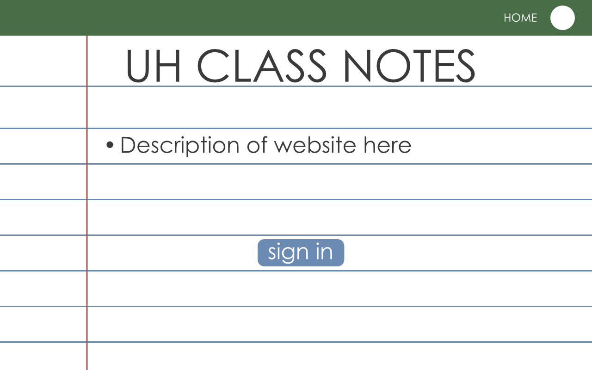
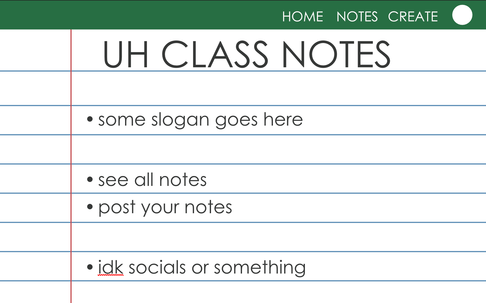
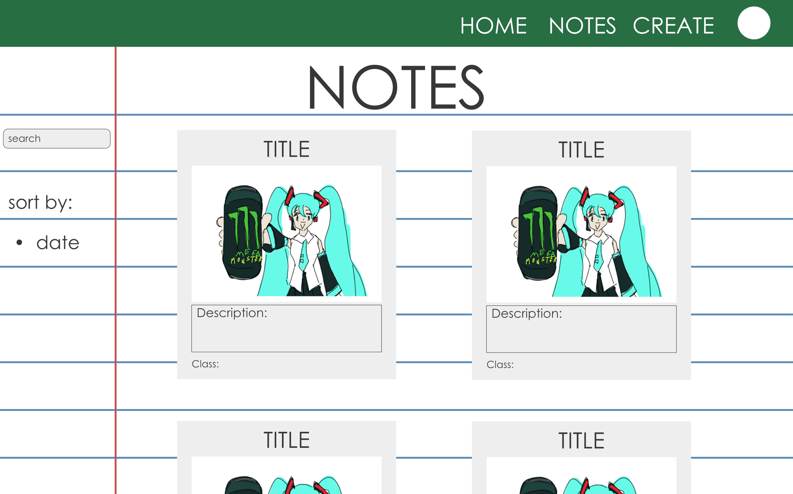
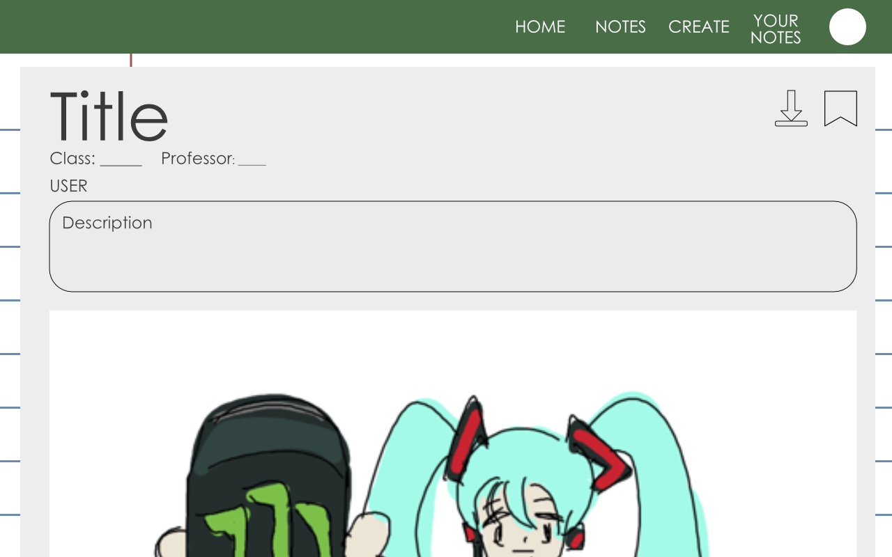
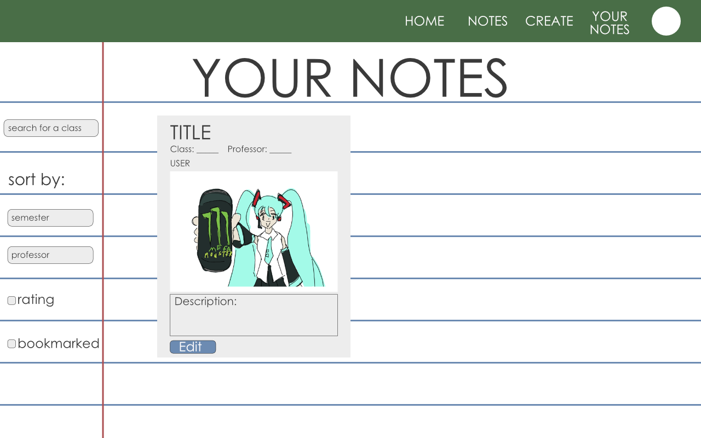
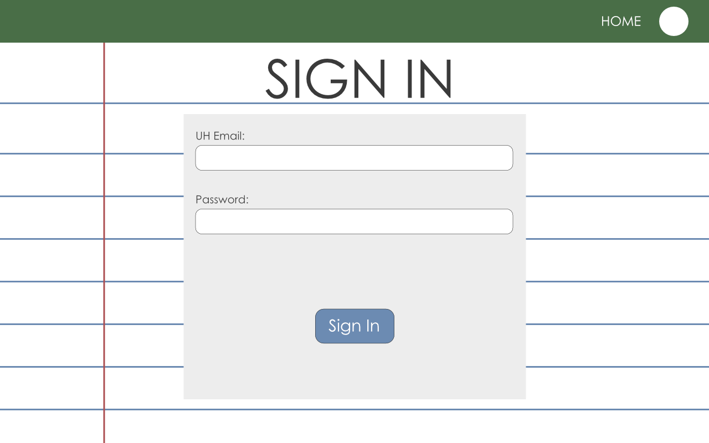
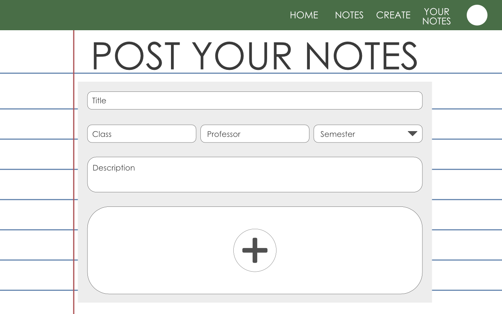
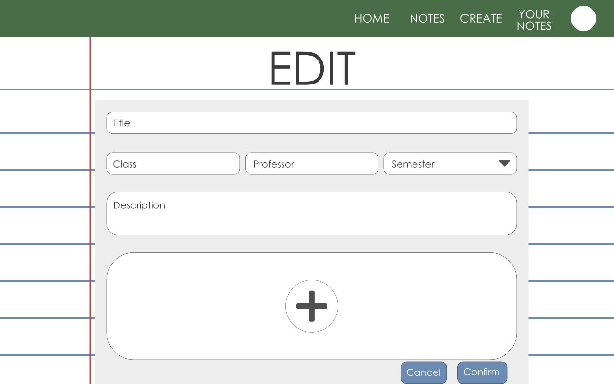

# UH Class Notes

## Table of contents
* [Overview](#overview)
* [Deployment](#deployment)
* [User Guide](#user-guide)
* [Community Feedback](#community-feedback)
* [Developer Guide](#developer-guide)
* [Development History](#development-history)
* [Continuous Integration](#continuous-integration)
* [Walkthrough](#walkthrough)
* [Example enhancements](#example-enhancements)
* [Team](#team)

## Overview
The Problem Students at UH Mānoa often have a hard time finding reliable study materials for their specific classes. General note-sharing websites are full of ads, require paid subscriptions, or contain notes that do not match what our local professors actually teach.

The Solution NoteShare Mānoa is a simple, free website built specifically for UH students. Users must register with a valid @hawaii.edu email address. This keeps the site safe and focused on our campus. Students can upload, search, and rate class notes, study guides, and project examples. The site organizes all materials by course number, semester, and professor name so students can find exactly what they need.

## Deployment
- [Link to the live deployed application](https://github.com/uh-class-notes/uh-class-notes)
- [Brief notes on the deployment environment or hosting service]

## User Guide
### Home Page
Home Page: A clean page built with Bootstrap 5 that explains what the site does. It features a large button to “Sign in with UH Email”.

### Landing Page
User Profile Page: A page that shows the notes a student has uploaded, the notes they have saved, and the classes they are currently taking.

### Note Viewing Page
Note Viewing Page: A page where users can view all posted notes or click on a card to read a specific document. On the side, there is a search bar for specific classes and a sort by feature that filters by semester, professor, and whether the user bookmarked a note.

### Read Note Page
Read Note Page: Accessed from clicking on a card form the Note Viewing Page. Displays all images in the post in a expanded view along with the title, class, professor, and semester. There is a bookmark and now a download button in the top right that allows users to save a specific note.

### Your Notes Page
Your Notes Page: A similar page to Note Viewing Page that displays all the notes the user has created. Buttons on the side still allow for sorting by class, semester, and professor. The card now has a button that allows for the user to edit their post.

### Sign in and Sign up
Sign in Page: A form that allows users to sign in with their UH email and password.

### Create Note Page
Create Note Page: Displays a form for the posting of a user's notes. In the form, there is a text input for the title, name of the class, name of the professor, and a description of the notes. A dropdown is used for selecting a semester. A section for uploading images is at the bottom.

### Edit Note Page
Edit Note Page: Similar to Create Note Page. Displays the details of the current post and allows for the original user to edit aspects of it. At the bottom there is a cancel or confirm button that saves the changes.

## Community Feedback
- [Brief invitation to users to share their experience]
- [Link to feedback form]

## Developer Guide
### Installation
- [Step 1: Prerequisites]
- [Step 2: Repository setup (clone/fork/template)]
- [Step 3: Dependency installation command]
- [Step 4: Command to run the application locally]

### Application Design
- [Base templates, boilerplates, or architectural patterns used]
- [Links to relevant external documentation]

### Data Model
- [Description of primary collections/entities]
- [Description of join collections or many-to-many relationships]

### Initialization
- [Details on configuration/settings files]
- [Instructions for loading default data or assets]

### Quality Assurance
#### ESLint
- [Instructions for running the linter]
- [Expected successful output example]

#### End-to-End Testing
- [Testing framework used]
- [Instructions for running tests in development mode]
- [Instructions for running tests in continuous integration (CI) mode]

## From Mockup to Production
- [List of security-related, performance, or production-ready changes required or implemented]

## Continuous Integration
- [CI status badge]
- [Brief description of the CI pipeline (e.g., GitHub Actions, what it runs)]
- [Link to the workflow definition file]

## Development History
- [Brief description of the project management methodology used, e.g., Issue Driven Project Management]

### Milestone 1: [Milestone Name]
- [Goal of the milestone]
- [Link to Project Board and/or Screenshot]

### Milestone 2: [Milestone Name]
- [Goal of the milestone]
- [Link to Project Board and/or Screenshot]

### Milestone 3: [Milestone Name]
- [Goal of the milestone]
- [Link to Project Board and/or Screenshot]

## Walkthrough 
- []

## Example enhancements
- [List of potential future improvements, stretch goals, or simple tasks for new developers to practice with]

## Team
- [Brian Joseph](https://github.com/bjoseph923)
- [Kenneth Chun](https://github.com/Kenneth-Chun)
- [Caden Sato](https://github.com/CSato8)
- [Walker Sun](https://github.com/wsun6)

### Team Documentation
- [Team Collaboration Agreement](https://docs.google.com/document/d/1-0eQiXwZ9dPu8a4zg0SXt7MwM6YCHCtMapUfO-PRrIM/edit?usp=sharing) *(Public view-only link)*

## Team Contract
- https://docs.google.com/document/d/1-0eQiXwZ9dPu8a4zg0SXt7MwM6YCHCtMapUfO-PRrIM/edit?tab=t.0#heading=h.ovwpe872mtfl
